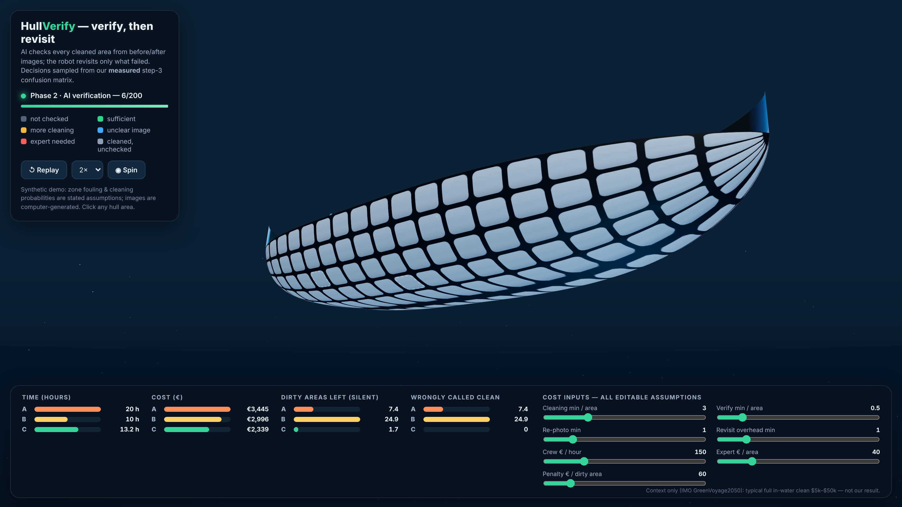

   

# Hull Cleaning Verification — Synthetic Dataset + Decision Rules

## IMPORTANT: say this in the pitch
These images are **computer-generated (synthetic)**, not real hull photos.
They simulate a painted hull plate with biofouling, partial cleaning, murky/blurred
water, and rust damage. Results on this data demonstrate that the **pipeline works
end-to-end**; they are **not evidence of real-world accuracy**. Say exactly that.

## What's inside
- `dataset/` — 48 before/after pairs (96 jpg) + `labels.csv`
  - labels: `sufficient` (14), `more_cleaning` (14), `unclear_image` (10), `expert_inspection` (10)
  - columns: pair_id, zone, before_file, after_file, label, split (tune/test)
  - zones: expert pairs sit in sensitive zones (sea_chest, propeller, anodes)
- `generate_dataset.py` — regenerates everything (seeded, reproducible)
- `classify.py` — the four-outcome decision rules + evaluation; writes `results.json`
- `results.json` — per-pair predictions + confusion matrices (feed this to the 3D view/dashboard)
- `contact_sheet.jpg` — one example pair per label

## Measured results (held-out test split, n=24)
Thresholds were tuned on the tune split ONLY; these are honest held-out numbers.

| | Our rules | Naive baseline (one fixed threshold) |
|---|---|---|
| Accuracy | 20/24 = **83%** | 14/24 = 58% |
| Dirty areas wrongly passed as clean | **0 / 12** | 0 / 12 |
| Failure mode | 4 clean areas sent for re-cleaning (safe, costs a revisit) | Calls all 5 murky images "sufficient" (dangerous) and cannot flag expert cases |

The baseline comparison is the key slide: without the "unclear image" outcome,
a simple threshold confidently passes images where nothing can actually be seen.

## How the rules work (classify.py)
1. Photo quality first: blur (Laplacian variance) or darkness → `unclear_image`.
2. Fouling score: fraction of pixels far from the estimated clean paint colour (median).
3. Score ≤ zone threshold → `sufficient` (sensitive zones have a stricter threshold).
4. Dirty + (no improvement over "before", or very high score, or sensitive zone) → `expert_inspection`.
5. Otherwise → `more_cleaning`.

## Run it
```
python3 generate_dataset.py     # regenerate images (optional)
python3 classify.py dataset/    # evaluate + write results.json
```
Needs: Python 3, numpy, Pillow.

## Limitations (put these on the limits slide)
- Synthetic images, not real hulls or real water.
- Small test set (24 pairs) — indicative only.
- Zones are assigned labels, not real geometry.
- Expert detection relies on zone + "no improvement"; real damage detection would need real data.
- Thresholds fitted to this synthetic distribution; real deployment would need re-tuning.

## Step 3 full version: `step3_decision_rules.py` (OpenCV + Lab + auto-tune)
Run: `python3 step3_decision_rules.py dataset/`  -> writes `results_step3.json`
Held-out TEST split (n=24), thresholds auto-tuned on the tune split only:

| | Rules | Naive baseline | Logistic regression (step 5) |
|---|---|---|---|
| Accuracy | 23/24 = **96%** | 14/24 = 58% | 24/24 = 100% |
| Dirty passed as clean | **0/12** | 0/12 | 0/12 |
| Failure mode | 1 more_cleaning sent to expert (safe) | calls all 5 murky images "sufficient" (dangerous) | none on this small set |

Caution for the pitch: 100% for the classifier on 24 synthetic pairs does NOT mean
a perfect model - say "on this small synthetic test set". The baseline row is the
key story: without the unclear-image outcome, murky photos get passed as clean.

## Steps 4 & 5: simulation + 3D viewer
- `step4_simulation.py` -> runs 1000 hulls x 200 areas; AI decisions sampled from the
  MEASURED step-3 test confusion matrix; writes sim_results.json + sim_results.js.
  Average per hull: A(repeat all): 400 visits, 7.4 dirty left silently. B(trust one pass):
  200 visits, 24.9 dirty left. C(verify+revisit): 200 visits + 200 checks + ~19 re-photos
  + ~19 targeted revisits + ~6 expert-flagged, only 1.7 dirty left unflagged, 0 wrongly-clean.
  Zone fouling/cleaning probabilities are ASSUMPTIONS (listed in the file) - say so.
- `hull_viewer.html` -> 3D demo (Three.js from CDN, needs internet; hull generated from
  code, no downloaded model). Open it directly in a browser from this folder AFTER running
  step4. Shows: cleaning pass -> AI verification (4 colours) -> targeted revisits; click
  any area for before/after images + reason; bottom panel = strategy A/B/C bars with live
  cost sliders. Replay + speed buttons top-left. `hull_viewer_preview.png` = screenshot.

## Steps 6 & 7: operator approval + honesty report
- Step 6 (in `hull_viewer.html`): after AI verification the run PAUSES on an
  "Operator approval required" card - "revisit N - expert M - K re-photos taken".
  Approve starts the targeted revisits; "Adjust plan" = edit mode (click any area to
  cycle sufficient -> more cleaning -> expert; overrides are logged); "Decision log
  (CSV)" downloads area,zone,images,AI answer,final answer,operator action,time for
  all 200 areas - the paperwork-proof angle.
- Step 7: `python3 step7_tests.py` -> prints and writes `step7_report.md`:
  rules-vs-baseline table (test split only), the wrongly-"sufficient" rate,
  sensitivity sweeps, and the limits slide ready to paste. Honest break-even found:
  C is NOT cheapest when the dirty-area penalty is <= EUR 20 or verification takes
  >= 2 min/area - say that in the pitch; C still remains the only strategy that
  KNOWS which areas stayed dirty.
